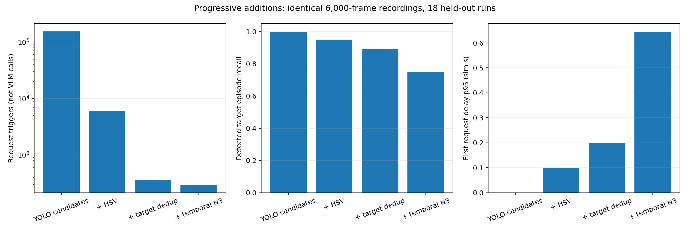
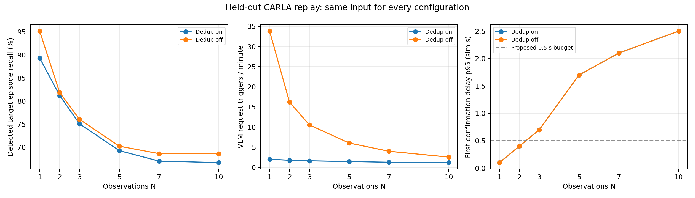
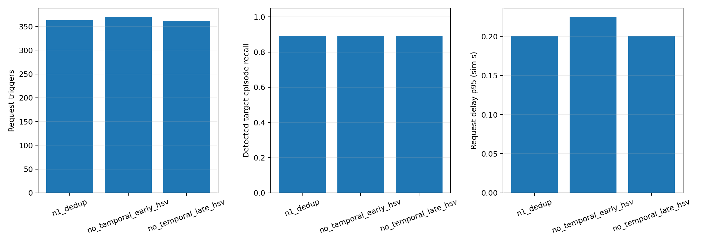

> 이 문서는 이전30개 전체 비교의 결과다. 사용자가 이후 한 세트6,000프레임·추가 누락0을 우선하도록 범위를 변경했다. 최신 결과는 [단일 세트 후속 검증](../single_set_filter_study/REPORT.ko.md)에 별도로 기록한다.

# 필터를 단계적으로 추가하며 검증한 결과

**10Hz × 시뮬레이션 10분 = 실행당 6,000장.** 새로 수집한 30개 녹화·총 180,000장을 모든 비교에 동일하게 사용했다. 이전 3분 자료는 이 평가에 섞지 않았다. 실제 VLM은 호출하지 않았다.

## 제안과 검증의 흐름

고비용 검증에 모든 검출을 보내기 전에 저비용 필터를 조합해 후보를 줄이는 구성을 제안했다. 공통 추적 기반에서 HSV, 대상별 중복 억제, 연속 확인을 차례로 추가한 비교를 설계하고, 각 단계의 요청 절감·목표 손실·확인 지연을 함께 확인했다. 이 순서는 비교를 설명하기 위한 구성 순서이며 실제 과거 개발 순서를 만들어낸 서술이 아니다. 연속 확인을 사용할 때의 실제 처리 순서는 추적 → 연속 확인 → 목표 색 gate → 중복 억제이다.

## 변인 통제

- Town10HD_Opt: 3환경 × 차량 30/70대 × seed 5개 = 30개. 카메라 위치는 앞선 파일럿에서 고정한 위치를 그대로 사용했다.
- 개발 12개(72,000장), 평가 18개(108,000장). 같은 원본RGB에서 YOLO/HSV를 한 번 계산하고 저장했다. 28개 구성은 동일 검출·색상·시뮬레이션시각을 공유하며 내부 상태는 독립적이다.
- 이전과 같은 모델/HSV/추적/dedup 임계값을 유지했다. 목표 색은 파랑이다. CARLA actor ID는 평가에만 사용했다.
- 정답 연결은 IoU≥.30, 상위후보 차이≤.05이면 모호함으로 분리한다. GT 투영과 raycast는 근사이며, 미연결 요청을 모두 오검출로 부르지 않는다.
- 요청 수는 VLM을 요구했을 트리거다. 실제 VLM 정확도·응답·최종 경보 지연은 측정하지 않았다. 지연은 첫 검출부터 확인/트리거까지의 시뮬레이션시간이다.

## 필터를 추가했을 때

| 구성 | 목표 출현 도달 | 도달률 | 고유 차량 도달 | 요청 트리거 | 비목표 요청 | 미연결 요청 | 요청 지연p95(s) |
|---|---:|---:|---:|---:|---:|---:|---:|
| 기본 YOLO 후보 | 309/309 | 100.0% | 105/105 | 156109 | 53375 | 96225 | 0.000 |
| HSV 추가 | 294/309 | 95.1% | 104/105 | 6088 | 2 | 56 | 0.100 |
| 대상별 중복 억제 추가 | 276/309 | 89.3% | 102/105 | 363 | 2 | 38 | 0.200 |
| 연속 확인 N3 추가·검토 | 232/309 | 75.1% | 99/105 | 294 | 0 | 0 | 0.645 |

기본구성의 도달률은 YOLO에 검출된 목표출현을 분모로 사용하기 때문에 100%가 되는 기준값이다. 전체 실제 차량을 완벽하게 찾았다는 뜻이 아니다. 같은 차량의 재등장은 별도출현일 수 있고 30초 재요청 억제로 정상적으로 차단될 수 있으므로 고유 차량 지표도 함께 본다.

- **HSV 추가:** 요청156109→6088(96.1% 감소), 출현 도달률 차이-4.85%p. 이 변화에는 이득과 손실이 함께 포함된다.
- **중복 억제 추가:** 요청6088→363(94.0% 감소), 출현 도달률 차이-5.83%p. 이 변화에는 이득과 손실이 함께 포함된다.
- **연속 확인N3 추가:** 요청363→294(19.0% 감소), 출현 도달률 차이-14.24%p. 이 변화에는 이득과 손실이 함께 포함된다.

HSV를 끄면 재연결과 중복 억제의 연속성에도 색상 정보를 사용하지 않으므로, 그 비교는 색상 gate 하나만의 효과가 아니다. CPU 재생 시간에는 실제 HSV 연산이 없어서 전체 연산 비용 절감을 그 시간으로 입증하지 않는다.

## 연속 확인의 관측 수

기존 N3는 같은 track의 관측 세 개를 모아 unknown을 제외하고 투표한다. 세 번 모두 목표 색이라는 조건은 아니다. 판정 후 기록을 비우며, 1초를 넘는 관측 간격에서 초기화한다. 아래 표는 이 규칙의 관측 수만 바꾼 결과다. 투표 규칙 대안은 전체 결과표와 rules.png에 별도로 제공한다.

| N | 목표 출현 도달률 | 고유 차량 도달률 | 요청 | 확인p95(s) |
|---:|---:|---:|---:|---:|
| 1 | 89.3% | 97.1% | 363 | 0.100 |
| 2 | 81.2% | 97.1% | 319 | 0.400 |
| 3 | 75.1% | 94.3% | 294 | 0.700 |
| 5 | 69.3% | 91.4% | 262 | 1.700 |
| 7 | 67.0% | 90.5% | 230 | 2.100 |
| 10 | 66.7% | 91.4% | 214 | 2.500 |

개발 선택: **n1_dedup**. 개발에서만 N1 대비 도달 손실 ≤2%p·확인 지연 p95 ≤0.5초를 만족하는 설정을 골랐다. 이 선택을 고정한 뒤 평가했다.
개발 단계에서 기준 구성인 N1이 그대로 선택됐다. N1과 자기 자신의 차이 구간 [0,0]을 연속 확인의 추가 가치에 대한 검증 근거로 사용하지 않는다.

연속 확인의 이득도 함께 남긴다. N3에서 비목표 요청은 2→0, 미연결 요청은 38→0로 바뀌었다. 미연결 요청은 모두 오검출로 확인된 것이 아니다. 출현 도달 수와 고유 차량 도달 수의 차이도 구분해야 한다.

N2는 고유 차량 102/105, 요청 319, 확인 지연 p95 0.400초였다. 고유 차량을 한 번이라도 찾는 목표만 중시하면 다른 교환 관계를 검토할 여지가 있다. 그러나 이번 사전 선택 기준은 출현 도달 손실도 포함하므로, 평가 뒤 목표를 바꿔 N2를 최종 승자로 재선택하지 않았다.

N3 자체의 사전 조건 판정: **미충족**. 최종 판정은 평가 자료에서 임의로 N을 다시 고르지 않고 개발에서 고정한 선택의 재현성으로 판단했다.

### 연속 확인의 판정

새 개발 자료의 선택과 평가 재현성을 함께 보았을 때, 연속 확인을 최종 구조에 유지할 사전 조건을 충족한 선택을 확인하지 못했다. 연속 확인은 순간 오판을 줄이려 추가해 검증했으나 사전 유지 조건을 입증하지 못해 최종 구성에서 제외한 시행착오로 분류한다. 관측된 요청 절감·목표 손실·지연은 위 표에 각각 제시했다. 기준 미충족은 효과가 전혀 없다는 증명이 아니며, 모든 환경에서 무의미하다는 뜻도 아니다. 평가 결과에서 다른 N을 사후 선택해 개발 선택인 것처럼 서술하지 않았다.

N3−N1 출현 도달률 차이의 녹화 단위 paired bootstrap 95% 구간: [-17.68,-10.47]%p. 18개 평가 녹화를 단위로 2,000회 재표집했다. 여러 구간은 탐색적이고 다중 비교 보정은 없다.

지연 p95는 성공 출현에 조건부다. 누락을 빼서 빨라 보이는 효과를 피하기 위해 누락 수와 공통 성공 출현의 paired 지연도 함께 제공한다. 연속 관측 오류가 독립이라는 가정은 하지 않았다.

## 배치 변경 비교

| 배치 | 목표 출현 도달률 | 고유 차량 도달 | 요청 | 비목표 요청 | 미연결 요청 | 요청p95(s) |
|---|---:|---:|---:|---:|---:|---:|
| HSV 라벨 → 추적 → 현재 색 gate → 중복 억제 | 89.3% | 102/105 | 363 | 2 | 38 | 0.200 |
| 목표 색 검출만 남김 → 추적 → 중복 억제 | 89.3% | 103/105 | 370 | 2 | 36 | 0.225 |
| 색상 없이 추적 → 현재 색 gate → 중복 억제 | 89.3% | 102/105 | 362 | 2 | 38 | 0.200 |

배치 대안은 순서뿐 아니라 추적에서 색상 정보를 사용하는 방식도 바꾼다. 추적에 의존하는 중복 억제를 앞으로 옮기거나, 색상 확인 전에 쿨다운을 소모하게 하는 구성을 동등한 순서 변경으로 취급하지 않았다.

배치별 차이는 여러 지표에 걸친 교환 관계다. 위 결과만으로 특정 배치가 모든 지표에서 우월하거나 유일한 최적이라고 주장하지 않는다. 배치 비교는 탐색적이다.

## 시행착오·한계

- 3분/1,800장 비교는 초기 탐색 자료로 보존했다. 원래 기준과 맞추기 위해 10Hz/600초/6,000장으로 다시 수집했다. 이전 자료의 결론을 새 시험의 답으로 고정하지 않았다.
- 조건과 seed는 초기 탐색과 공유하므로 완전히 새로운 시나리오군에 대한 검증은 아니다. 환경·밀도별 seed 재사용의 상관을 녹화 단위 신뢰구간이 모두 반영하지 못할 수 있다.
- 동일 입력 내 설정 비교는 통제했지만 서로 다른 녹화가 bit 단위로 같지는 않다. 같은 지도 서버를 순서대로 쓰므로 신호등 위상 등 world 상태가 이어질 수 있다.
- 사용자 요청으로 30번째 녹화에서 수집을 끝내 두 번째 지도를 추가하지 않았다. Town10HD_Opt의 한 카메라, 파란 목표 색에 한정한다. 다른 지도·실제 도로·야간·모든 색상·차종으로 일반화하지 않는다.
- 실제 VLM과 후단 큐·최종 경보 지연은 측정하지 않았다. 원자료는 센서 입력에서 계산한 YOLO/HSV 캐시이며 저장 JPEG를 다시 추론한 것이 아니다.
- 모든 구성의 GT 연결과 출현 분모는 공통이다. GT 근사 오류와 1초 출현 구분 정의, 영상 경계의 영향이 남을 수 있어 보조 표와 사례를 제공한다.

## 원자료·검증

2%p 도달 손실과 0.5초 확인 지연은 비교 전에 정한 운영 허용 기준이다. 이 자료에서 도출한 최적 임계값이나 도로 안전 표준을 뜻하지 않는다.

검증된 원자료: 30개 녹화 / 180000프레임 / 180000이미지. [무결성목록](results/archive_inventory.csv).

[전체집계](results/aggregate.csv) · [조건별결과](results/stratified.csv) · [신뢰구간](results/paired_confidence_intervals.csv) · [단계추가비교구간](results/stage_paired_confidence_intervals.csv) · [출현별결과](results/episodes.csv) · [paired지연](results/paired_delays.csv)

[누락양상](results/temporal_miss_diagnosis.csv) · [경계민감도](results/boundary_sensitivity.csv) · [실제장면](results/scene_comparison.jpg) · [사례이미지](results/evidence/cases.csv)

원본 JPEG와 JSONL은 runs/<조건>/에 로컬 보존한다. 대표 이미지·결과표·재현 코드는 저장소에 포함한다.
