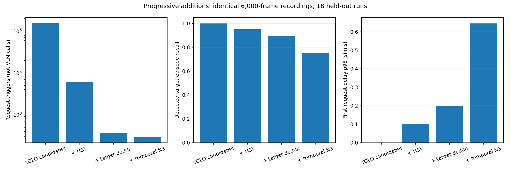
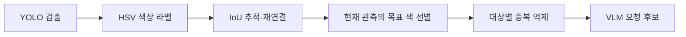

> 이 문서는 이전30개 전체 비교의 결과다. 사용자가 이후 한 세트6,000프레임·추가 누락0을 우선하도록 범위를 변경했다. 최신 결과는 [단일 세트 후속 검증](../single_set_filter_study/REPORT.ko.md)에 별도로 기록한다.

# 필터를 쌓아 검증한 최종 구성

**이번 운영 기준에서는 HSV 색상 선별과 대상별 중복 억제를 유지하고, 추가 관측을 기다리는 연속 확인은 제외한다.** 개발 자료에서 N1을 선택했고, 평가 자료에서도 N3는 목표 출현 손실과 확인 지연의 허용 기준을 충족하지 못했다. 비교한 범위의 권장 구성이며 유일한 절대 최적을 주장하지 않는다.

## 같은 자료로 개선을 비교함

화면 창 없는 CARLA에서 10Hz × 10분 × 6,000장인 녹화 **30개, 총 180,000장**을 저장했다. 처음에는 40개를 계획했으나 사용자 요청으로 30번째에서 수집을 끝냈다. 31번째는 시작하지 않았다.

Town10HD_Opt의 맑은 낮·낮은 태양 고도·비, 차량 30/70대, seed 5개를 조합했다. 개발 12개에서 설정을 선택해 고정한 뒤 평가 18개를 분석했다. 모든 비교는 동일한 원본 센서 입력의 YOLO·HSV 캐시를 사용하고 내부 상태를 따로 유지한다. JPEG는 확인용 이미지이며 다시 추론하지 않는다. 실제 VLM은 호출하지 않았다.

## 필터를 추가한 결과

아래 수치는 평가 18개 녹화의 결과다. ‘출현’에는 같은 차량의 재등장이 포함되고, ‘고유 차량’은 녹화 안의 같은 actor를 한 번만 센다.

| 구성 | 요청 트리거 | 목표 출현 도달 | 고유 차량 도달 | 요청 지연 p95 |
|---|---:|---:|---:|---:|
| 공통 추적 + YOLO 후보 | 156,109 | 309/309 | 105/105 | 0.000초 |
| HSV 추가 | 6,088 | 294/309 | 104/105 | 0.100초 |
| 대상별 중복 억제 추가 | 363 | 276/309 | 102/105 | 0.200초 |
| 연속 확인 N3 추가·검토 | 294 | 232/309 | 99/105 | 0.645초 |

HSV 추가는 요청을 **96.1%**, 중복 억제 추가는 그다음 요청을 **94.0%** 줄였다. 두 필터를 사용한 구성은 최초 후보 대비 요청을 **99.77%** 줄이고 검출된 고유 목표 차량 105대 중 102대에 도달했다. 동시에 출현과 고유 차량 도달 손실도 발생했다. 중복 억제 단계의 손실을 모두 의도한 재등장 억제라고 설명하지 않는다.

YOLO 기준의 출현 도달률 100%는 검출된 목표 출현으로 정의한 기준값이다. 실제 모든 차량을 100% 찾았다는 뜻이 아니다. HSV 유무는 추적의 색상 정보와 재연결에도 영향을 주므로, 색상 gate만 떼어낸 효과로 해석하지 않는다.

## 연속 확인을 시행착오로 기록하는 이유

기존 N3는 같은 track의 관측 세 개를 모아 unknown을 제외하고 투표한다. 세 번 연속 목표 색이어야 한다는 규칙이 아니다. N=1/2/3/5/7/10과 투표 규칙 대안을 별도로 비교했다.

| 관측 수 | 목표 출현 도달률 | 고유 차량 도달 | 요청 | 확인 지연 p95 |
|---|---:|---:|---:|---:|
| N1 | 89.32% | 102/105 | 363 | 0.10초 |
| N2 | 81.23% | 102/105 | 319 | 0.40초 |
| N3 | 75.08% | 99/105 | 294 | 0.70초 |
| N5 | 69.26% | 96/105 | 262 | 1.70초 |
| N7 | 66.99% | 95/105 | 230 | 2.10초 |
| N10 | 66.67% | 96/105 | 214 | 2.50초 |

N3는 N1보다 요청을 19.0% 줄였다. 연결된 비목표 요청은 2→0회, 미연결 요청은 38→0회로 줄었다. **미연결 38회가 모두 오검출로 확인된 것은 아니다.** 따라서 연속 확인에 아무 효과가 없었다고 쓰지 않는다.

반면 도달한 목표 출현은 44건 감소했고, 고유 차량 도달은 순수하게 3대 감소했다. N1만 도달한 차량은 5대, N3만 도달한 차량은 2대였다. 목표 출현 도달률 차이는 −14.24%p, 녹화 단위 paired bootstrap 95% 구간은 [−17.68, −10.47]%p였다. 확인 지연 p95도 0.70초로 사전 0.5초 기준을 넘었다.

N2는 고유 차량 도달 수가 N1과 같고 요청이 44회 적었다. 다만 도달한 차량 집합은 같지 않다. 각각의 구성에서만 도달한 차량이 2대씩 있었다. 출현 도달률 손실도 사전 2%p 기준을 넘었다. ‘차량을 한 번이라도 찾기’만 중시하면 다른 선택을 검토할 여지가 있지만, 평가 뒤 목적을 바꿔 N2를 승자로 고르지 않았다.

**기록할 결론:** 순간 색상 오판을 줄이기 위해 연속 확인을 추가해 검증했다. 요청 절감 효과는 관측됐지만, 이번 운영 기준의 목표 출현 손실·확인 지연 조건을 충족하지 못해 최종 구성에서 제외한 시행착오로 분류한다.

## 누락을 추적해 확인함

N1에서 색상이 확인되고 N3에서는 확인되지 않은 출현은 59건이었다. 그중 50건은 연결된 실제 관측이 3개보다 적었다. 나머지 9건은 여러 색상과 모음 단위 투표가 관련된 사례이며, 이번 자료에서 관측이 서로 다른 track으로 나뉜 분류는 0건이었다.

녹화 시작·끝 1초에 걸친 출현을 제외해도 N1 272/303, N3 231/303으로 차이가 남았다. 이는 경계 민감도 분석이며 별도 워밍업 실험은 아니다. [누락 진단](results/temporal_miss_diagnosis.csv) · [경계 분석](results/boundary_sensitivity.csv) · [실제 사례 이미지](results/evidence/cases.csv)

## 배치를 바꾼 결과와 권장 구조

| 배치 | 출현 도달 | 고유 차량 도달 | 요청 | 요청 지연 p95 |
|---|---:|---:|---:|---:|
| HSV 라벨 → 추적 → 현재 색 gate → 중복 억제 | 276/309 | 102/105 | 363 | 0.200초 |
| 목표 색 검출만 남김 → 추적 → 중복 억제 | 276/309 | 103/105 | 370 | 0.225초 |
| 색상 없이 추적 → 현재 색 gate → 중복 억제 | 276/309 | 102/105 | 362 | 0.200초 |

어느 배치도 모든 지표에서 우월하지 않았다. 목표 색을 먼저 남기는 대안은 고유 차량 1대에 더 도달했지만 요청이 7회 많았고, 색상 없이 추적하는 대안은 같은 총 도달 수에서 요청이 1회 적었다. 배치 비교는 탐색적이며 이 작은 차이로 절대 최적을 주장하지 않는다.

현재 권장 구조는 다음과 같다.

색상 라벨은 추적의 재연결에 쓰이고, 중복 억제는 추적 결과와 대상 키에 의존한다. 이 의존 관계를 유지하면서 추가 관측 대기를 제거한다. 실제 VLM과 후단 큐·알림 지연은 이번에 측정하지 않았다.

## 범위와 근거

한 지도·한 카메라·파란 목표 색에 대한 결과다. 이전 탐색과 조건·seed를 공유하고, 환경·밀도별 seed 재사용의 상관을 녹화 단위 구간이 모두 반영하지 못할 수 있다. GT 투영·연결은 근사다. 지연은 성공 출현에 조건부이므로 누락과 고유 차량 지표를 함께 제시했다.

원본 이미지 180,000장과 입력 캐시는 로컬에 보존한다. 이미지마다 해시를 기록했고, 모든 JPEG의 시작·끝 마커와 표본 해상도·연속 frame/index/시각·actor 정리까지 검증했다. 저장소에는 결과표·대표 이미지·코드를 포함한다. 문서에는 시험 날짜를 기록하지 않는다.

[전체 보고서](REPORT.ko.md) · [제안·시행착오·해결 과정](RESEARCH_LOG.ko.md) · [고정 명세와 범위 변경](PROTOCOL.ko.md) · [검증 기록](VERIFICATION.md) · [전체 결과](results/aggregate.csv) · [무결성 목록](results/archive_inventory.csv)
