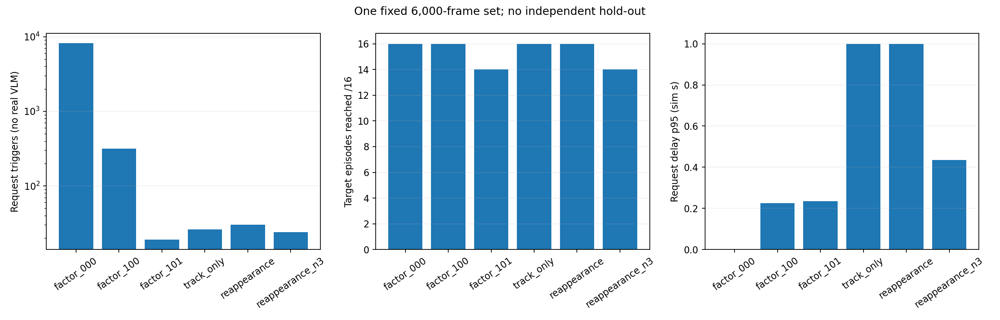
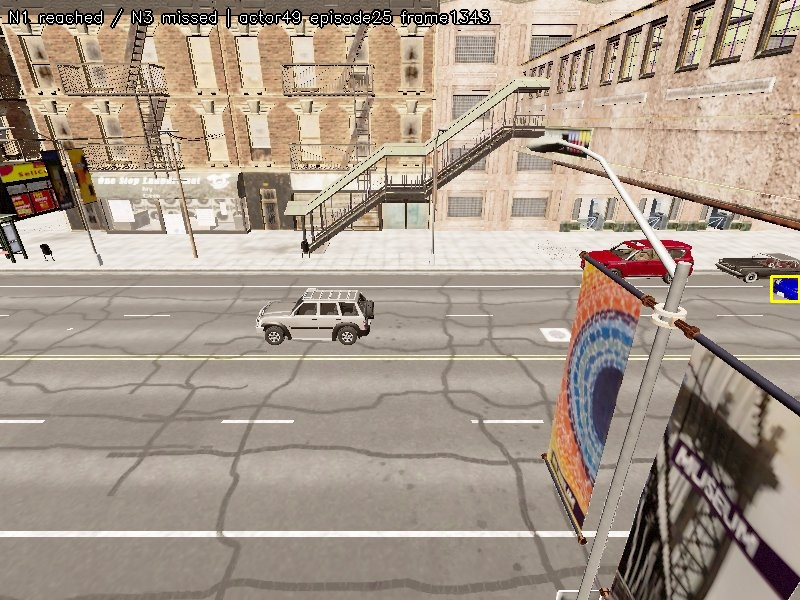
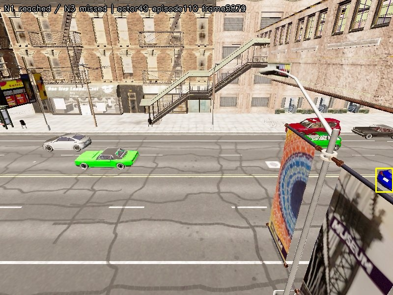

> 보조 기록: 이 문서의 모든 출현 보존 기준은 사용자 요구를 과도하게 해석한 기준이었다. 최종 판단은 [차량 단위 결과 정리](USER_SUMMARY.ko.md)와 [30세트 구성·평균](EXPERIMENT_CONTEXT.ko.md)을 따른다. 실험용26회 수정안은 채택하지 않았으며 추가 테스트는 중단했다.

# 단일 6,000프레임: 목표 보존을 우선한 필터 비교

**한 녹화·6,000프레임만 입력했다.** Town10HD_Opt 맑은 낮·차량30대·seed101·10Hz·10분. 기존 개발 자료의 첫 조건으로 고정했고 다른 영상은 읽거나 수집하지 않았다. 실제 VLM은 호출하지 않았다. 이전 전체 결과는 별도로 보존했다.

## 목표 누락을 직접 확인한 결과

CARLA 정답상 생성된 파란 차량은 4대이며 이 세트에서는 모두 YOLO에 검출됐다. 기준에서 도달한 검출 출현 16건, GT 가시 출현 11/11건을 actor/episode ID 집합으로 대조했다. 개수만 같다고 무손실로 판정하지 않았다.

| 구성 | 요청 | 목표 차량 도달 | 목표 출현 도달 | 추가 출현 누락 | 확인p95(s) | 요청p95(s) |
|---|---:|---:|---:|---:|---:|---:|
| 기본 YOLO 후보 | 8167 | 4/4 | 16/16 | 0 | 0.000 | 0.000 |
| HSV 추가 | 317 | 4/4 | 16/16 | 0 | 0.225 | 0.225 |
| 기존 중복 억제 추가 | 19 | 4/4 | 14/16 | 2 | 0.225 | 0.235 |
| 새 track의 첫 요청 보장 | 26 | 4/4 | 16/16 | 0 | 0.225 | 1.000 |
| 관측 공백 후 재요청 추가 | 30 | 4/4 | 16/16 | 0 | 0.225 | 1.000 |
| 동일 수정 dedup에 N3 추가 | 24 | 4/4 | 14/16 | 2 | 0.435 | 0.435 |

선택: **track_only**. 기준 대비 추가 차량 누락 0건·추가 검출 출현 누락 0건·추가 GT 가시 출현 누락 0건이며, 요청은8167→26회(99.68% 감소)다.

기존 구조는 차량4대는 모두 찾았지만 목표의 첫 출현1건과 재등장1건이30초 cooldown/fragment alias로 차단됐다. 선택한 track-only 수정안은 HSV·추적·현재 색 선별을 그대로 두고 새track의 첫 요청을 인접track에 묶지 않는다. 같은track의30초 cooldown은 유지한다. 관측 공백 후 재요청 대안도 비교했으나 목표 보존은 같고 요청이30회로 늘어 선택하지 않았다. 연속 확인은 추가하지 않는다. 이 구현은 실험용이며 운영 기본 경로를 자동 변경하지 않았다.

선택안의 요청 지연 p95는 1.000초, 최대 3.100초다. HSV만 쓴 경우 p95 0.225초, 최대 0.300초보다 지연이 늘었다. 목표 출현마다 적어도 한 번 도달했다는 뜻이며, 지연 없는 즉시 전달을 보장한 것은 아니다.

## 연속 확인을 제외한 수치적 근거

아래는 **모든 N에서 dedup을 끈 동일 조건**이다. 따라서 목표 출현 손실을 중복 억제와 분리해 확인한다. 기존 N 규칙은 unknown을 제외한 모음 투표이며 연속N회 모두 목표라는 규칙이 아니다.

| N | 요청 | 차량 도달 | 출현 도달 | 추가 출현 누락 | 확인p95(s) |
|---:|---:|---:|---:|---:|---:|
| 1 | 317 | 4/4 | 16/16 | 0 | 0.225 |
| 2 | 148 | 4/4 | 14/16 | 2 | 0.335 |
| 3 | 100 | 4/4 | 14/16 | 2 | 0.435 |
| 5 | 60 | 4/4 | 13/16 | 3 | 1.900 |
| 7 | 36 | 4/4 | 11/16 | 5 | 3.550 |
| 10 | 23 | 4/4 | 11/16 | 5 | 3.750 |

중복 억제를 꺼도 N3에서 출현2건이 이미 누락됐다. 따라서 새 중복 억제 정책 때문이라고 설명할 수 없다. N3의 요청 절감 효과도 관측됐다. 그러나 이번 요구는 목표 차량뿐 아니라 목표의 각 출현을 모두 보존하는 것이므로, 추가 출현 누락이 생기는 연속 확인은 제외한다. N3에서도 차량4대는 모두 도달했으며 모든 차량을 놓쳤다는 뜻은 아니다.

[기존 중복 억제의 누락·복구 시각](results/dedup_recovery.csv) · [N별 원자료](results/temporal_without_dedup.csv) · [누락 ID 목록](results/missed_reference_episodes.csv) · [사례 관측 수](results/temporal_miss_cases.csv)

## 범위와 재현

관측한 한 세트에서 추가 손실0을 확인한 결과다. 선택·비교가 같은 한 세트에서 이루어졌고 독립 평가가 없다. 기존 전체 자료나 모든 환경의 무손실로 일반화하지 않는다. GT 투영·연결도 근사다. 반복 프레임을 모두 VLM에 보내는 뜻이 아니라 각 목표 차량/출현이 최소한 번 요청 단계에 도달했는지 평가했다. 실제 VLM·큐·최종 경보의 누락은 측정하지 않았다.

모든6,000JPEG의 해시·마커를 검증하고 해상도를 표본 검사했다. 기존 원자료 image-set 해시와 일치한다. 입력 캐시는 원본 센서에서 얻은 검출·색상이며 JPEG를 재추론하지 않았다.

[고정 명세](PROTOCOL.ko.md) · [전체31구성](results/comparison.csv) · [선택과 무결성](results/decision.json) · [이미지별 해시](results/images.sha256)
