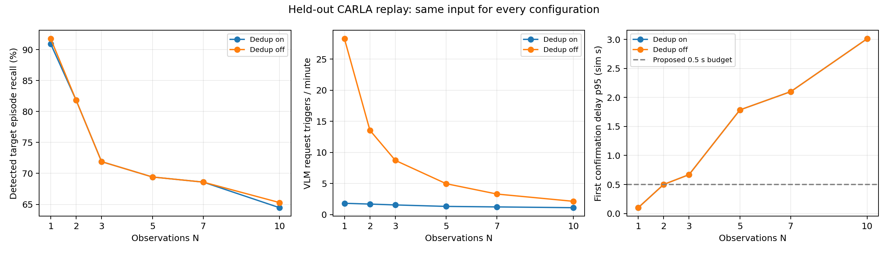
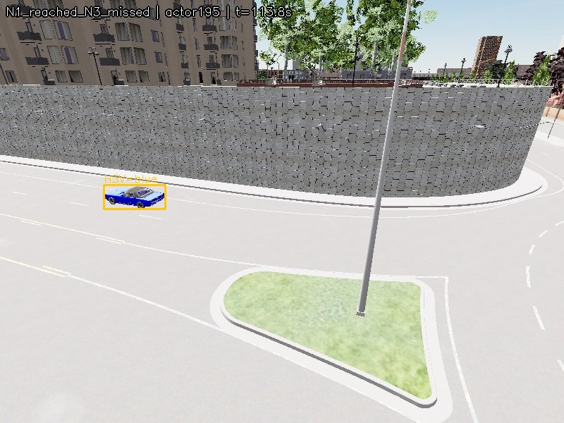

# 3프레임과 필터 구조 비교 실험

**현재의 3프레임 설정이 가장 적절하다는 근거는 얻지 못했다.** 이번 평가에서는 관측 수를 늘릴수록 요청은 줄었지만, 목표 출현을 놓치는 비율과 확인 지연이 증가했다. HSV 색상 선별과 중복 억제는 요청량을 줄이는 역할이 확인됐다. 정확히 현재의 배치 순서가 대안보다 우수하다는 근거는 약했다.

실험은 초기 경험적 설정을 사후 검증한 것이다. 이번 결과를 당시 3프레임을 선정한 이유로 소급해서 서술하면 안 된다.

## 실제로 수행한 범위

- **40개 녹화, 총 120분·72,000프레임.** 녹화 하나는 3분·10Hz이며, 동영상 파일 대신 이미지 1,800장과 프레임별 로그로 저장했다.
- 첫 지도 Town10HD_Opt: 맑은 낮/낮은 태양·흐림/비·젖은 노면 × 차량 30/70대 × seed 5개 = 30개.
- 두 번째 지도 Town03_Opt: 맑은 낮 × 차량 30/70대 × seed 5개 = 10개. 이 지도의 다른 날씨는 측정하지 않았다.
- 개발 16개와 평가 24개를 seed 단위로 분리했다. 같은 원본 YOLO·HSV 출력을 26개 구성에 재생했다. 설정마다 tracker·temporal·dedup 상태는 독립적이다.
- CARLA 0.9.13·RTX 3060에서 화면 창 없이 RGB를 렌더링하고 모든 프레임을 JPEG로 저장했다. 판단 입력은 JPEG 재추론이 아니라 원본 센서 영상에서 계산한 검출·색상 캐시다.
- 목표 색상은 파랑으로 고정했다. 다른 목표 색상 전체의 성능을 검증한 것은 아니다.
- 사용자 요청에 따라 실제 VLM은 본 비교에서 실행하지 않았다. 아래의 ‘요청’은 실제 호출 횟수가 아니라 **VLM 검증을 요청했을 트리거**다. 지시 이전 연결 확인용 이미지 1장 호출은 별도로 보존하고 결과에서 제외했다.

[실제 촬영 장면](results/scene_comparison.jpg) · [전체 상세 보고서](REPORT.ko.md) · [고정된 실행 정책](execution_policy.json)

## 1. 관측 수 비교

평가 24개 녹화에는 YOLO와 정답 연결이 가능한 목표 출현 121건, 고유 목표 차량 92대가 있었다. ‘출현’은 같은 차량이라도 검출이 1초 넘게 끊긴 뒤 다시 나타나면 새 구간으로 센다. 차량 수는 녹화별 actor를 구분해 집계했다.

아래는 HSV와 중복 억제를 사용하는 동일 조건이다. 확인 지연은 **해당 출현의 첫 YOLO 검출부터 목표 색상 확인까지의 시뮬레이션 시간**이다. VLM 응답이나 최종 경보 지연이 아니다. p95는 확인된 출현의 95백분위수다. 미확인 출현은 도달률에 반영한다.

| 관측 수 N | 도달한 목표 출현 | 출현 도달률 | 한 번이라도 요청된 고유 차량 | 요청 트리거 | 확인 지연 p95 |
|---:|---:|---:|---:|---:|---:|
| 1 | 110/121 | 90.9% | 83/92 (90.2%) | 131 | 0.10초 |
| 2 | 99/121 | 81.8% | 80/92 (87.0%) | 122 | 0.50초 |
| 3 | 87/121 | 71.9% | 77/92 (83.7%) | 112 | 0.67초 |
| 5 | 84/121 | 69.4% | 76/92 (82.6%) | 95 | 1.79초 |
| 7 | 83/121 | 68.6% | 75/92 (81.5%) | 89 | 2.10초 |
| 10 | 78/121 | 64.5% | 72/92 (78.3%) | 80 | 3.01초 |

N3는 N1보다 트리거를 131→112건으로 **14.5% 줄였지만**, 출현 도달률은 **19.0%p 낮았고**, 고유 차량 도달은 83→77대로 줄었다. N1에서만 요청된 고유 차량은 7대, N3에서만 요청된 차량은 1대였다. 재등장에 대한 정상 쿨다운 억제와 새 차량을 끝내 확인하지 못하는 경우를 구분해야 한다.

정답에 연결된 비목표 차량 요청은 N1과 N3 모두 0건이었다. N1에는 정답에 연결되지 않은 요청 6건이 있고 N3에는 없었다. **그 6건을 입증된 오검출 6건으로 부르지는 않는다.** GT 투영이나 연결의 한계로 실제 차량이 미연결됐을 수도 있다.

녹화 단위 paired bootstrap 2,000회의 N3−N1 출현 도달률 차이 95% 구간은 **−23.14~−14.40%p**였다. 이 입력에서는 요청 감소와 함께 상당한 도달률 손실이 관측됐다. 이 구간은 탐색적이며 여러 설정에 대한 다중 비교 보정을 하지 않았다.

## 2. 개발 단계에서는 2프레임이 선택됐지만 평가에서 재현되지 않았다

사전에 정한 선택 조건은 ‘N1 대비 출현 도달률 손실 2%p 이내, 확인 지연 p95 0.5초 이내’였다. 충족한 설정 중 비목표·미확정 요청, 총 요청, 낮은 N 순서로 골랐다.

개발 데이터에서 N1과 N2는 모두 79/92 출현에 도달했다. N2는 미연결 요청을 16→0건으로 줄였고 p95가 0.5초여서 선택됐다. 이 선택은 평가 결과를 읽기 전에 파일에 고정했다.

평가 데이터에서는 N2가 N1보다 110→99 출현으로 낮아졌다. 차이의 95% 구간은 **−14.29~−4.31%p**로, 사전 2%p 조건을 충족하지 못했다. 따라서 ‘개발에서 N2를 골랐으니 N2가 최적’이라고 결론 내리지 않는다. 평가 결과상 N1은 누락·지연 면에서 유리했지만, 이를 모든 운영 환경의 배포 최적값으로 확정한 것도 아니다.

[개발 선택 원본](results/dev_selection.json) · [신뢰구간](results/paired_confidence_intervals.csv)

## 3. 3프레임에서 무엇을 놓쳤는가

N1에서 목표 색이 확인됐지만 N3에서는 확인되지 않은 출현 24건을 프레임·track·색상 로그로 추적했다.

| 관측된 양상 | 출현 수 |
|---|---:|
| 해당 출현에서 실제 관측이 1~2개뿐 | 21 |
| 관측은 3개지만 track이 2개+1개로 나뉨 | 1 |
| 관측 5개 중 blue는 1개이고 나머지는 gray_silver 또는 black | 2 |

21건에서 부족했던 것은 영상 파일의 프레임 수가 아니라 **YOLO가 해당 차량을 실제로 검출하고 같은 차량에 연결할 수 있었던 관측 수**다. RGB에 차량이 보여도 모든 프레임에서 YOLO 관측이 생기는 것은 아니다.

아래 사례는 파란 차량을 한 번 검출해 N1은 통과했지만, N3가 필요한 관측을 채우지 못한 경우다. 전체 차종·날씨의 현상이라고 일반화하지 않는다.

기록 시작·끝 1초 이내에 걸친 출현을 제외한 민감도 확인에서도 N1은 103/113(91.2%), N3는 83/113(73.5%)였다. 영상 경계에 걸친 출현을 제외해도 차이가 남았다. tracker를 사전 예열해 다시 실행한 실험은 아니다. 이는 사후 설명용 확인이며 주평가 정의나 N 선택 기준을 바꾸지는 않았다.

[출현별 원인 추적](results/temporal_miss_diagnosis.csv) · [사례 이미지 목록](results/evidence/cases.csv)

## 4. 필터 구조에서 지지된 부분과 지지되지 않은 부분

모든 비교는 YOLO 검출을 공통으로 사용한다. 전체 프레임을 직접 VLM에 보내는 실험은 하지 않았다.

| 비교 | 요청 트리거 변화 | 목표 출현 도달 변화 | 해석 |
|---|---:|---:|---|
| 다른 필터 없이 HSV 추가 | 50,282→2,036 | 121→111 | 비목표·미확정 후보를 크게 줄이지만 HSV로 놓치는 목표도 있음 |
| HSV 조건에서 dedup 추가, N1 | 2,036→131 | 111→110 | 반복 요청 감소의 큰 부분을 담당 |
| HSV+dedup에서 N1→N3 | 131→112 | 110→87 | 추가 요청 감소보다 목표 손실이 중요한 문제로 드러남 |
| HSV+N3에서 dedup 추가 | 628→112 | 87→87 | 이 조건에서는 추가 목표 출현 손실 없이 반복 억제 |

HSV의 역할은 지지되지만 무손실 필터는 아니다. 개발용 실제 crop에서도 파란 Mustang이 gray_silver나 black으로 분류되는 경우가 보였다. 색상 판별의 안정성이 temporal 투표에도 영향을 준다.

현재 배치와 ‘HSV로 먼저 제거 후 추적’, ‘색상 없이 존재를 확인한 뒤 현재 색상 판별’은 평가에서 모두 87/121 출현에 도달했다. 트리거는 각각 112/112/111건, 요청 지연 p95는 0.67/0.84/0.81초였다. **현재의 정확한 순서가 유일하게 우수하다는 주장은 뒷받침되지 않았다.** 대안은 순서뿐 아니라 증거 사용 방식도 바뀌므로 순서만의 효과로 해석하지 않는다. 캐시 재생의 CPU 시간에는 실제 HSV 연산이 없어 계산량 절감도 입증하지 않았다.

[8조합 비교 그림](results/factorial.png) · [구조 대안 비교](results/architecture.png)

## 5. 3이라는 숫자와 투표 규칙은 구분해야 한다

현재 구현은 3개 관측을 묶어서 판정하고 초기화한다. `unknown`은 투표 분모에서 제외하므로 `blue, unknown, unknown`도 통과한다. 모든 색상이 알려졌다면 60% 규칙에서 N2는 2/2, N3는 2/3을 요구한다. 이때 N3는 오류 1개를 허용하는 가장 작은 관측 수지만, 그것만으로 실제 입력에서 N3가 최적이라는 뜻은 아니다. 인접 프레임의 오류가 서로 독립이라는 가정도 하지 않았다.

실제 평가에서 unknown을 분모에 포함한 2/3 규칙은 현재 N3와 같은 87/121 도달·112건 요청이었다. 3/3은 86/121로 낮아졌다. 슬라이딩 2/3도 87/121로 같았고, 후보는 628→1,767건으로 늘었다. 투표 규칙만 바꿔 이번 도달률 손실을 해결하지 못했다.

합성 입력에서는 가까운 같은 색 차량 두 대가 dedup 연속성 규칙에 의해 한 대로 묶이는 한계도 재현했다. 현재 매칭된 다른 track을 fragment의 부모로 쓰지 않는 대안은 합성 사례를 개선했지만, 실제 N3 평가에서는 고유 차량 도달률이 같았다. 이 대안을 production에 반영하지 않았다.

[규칙 비교](results/rules.png) · [합성 투표 결과](stress_votes.csv) · [합성 중복 억제 결과](stress_dedup.csv)

## 기록에 사용할 수 있는 결론

> 초기에는 짧은 시간의 관측 일관성을 확보하기 위해 3개 관측을 사용하는 경험적 설정을 적용했다. 이후 동일 CARLA 입력을 이용한 비교에서, 3개 관측은 1개 관측보다 요청 트리거를 줄였지만 짧은 검출 출현을 놓치고 확인 지연을 증가시키는 것으로 나타났다. 따라서 3개 관측을 일반적인 최적값으로 해석하지 않았다. HSV와 중복 억제의 효과를 시간적 확인의 효과와 분리해 평가했으며, 관측 수는 검출 지속시간과 목표 누락·허용 지연을 함께 고려해야 하는 운영 변수로 정리했다.

## 한계와 보존 자료

- 첫 지도 3환경과 두 번째 지도 맑은 낮만 비교했다. 실제 도로·야간·다른 카메라로 일반화하지 않는다.
- GT는 도장 설정·투영 box·중심 raycast에 근거한 근사다. IoU 모호성을 따로 분리했지만 연결 오류 가능성은 남는다. 표의 출현 도달률은 YOLO로 검출된 구간에 조건부이며 전체 차량 재현율이나 VLM 정확도가 아니다.
- 요청을 줄이는 과정에서 실제 VLM 정확도가 어떻게 바뀌는지는 측정하지 않았다. 실제 VLM·큐·최종 경보 지연도 측정하지 않았다.
- 실험 당시에는 production 기본 N3를 유지해 비교했다. **이후 사용자 결정으로 현재 production 실행 경로에서 시간적 확인을 제거했다.** 도입했지만 실제 검증에서 유지할 이점이 부족해 제외한 시행착오로 기록한다. 결과·실험 도구는 별도 실험 브랜치에 있다.
- [문제와 해결 과정](RESEARCH_LOG.ko.md), [상세 보고서](REPORT.ko.md), [전체 집계 CSV](results/aggregate.csv), [조건별 결과](results/stratified.csv), [실제 이미지·로그 위치](README.md)를 함께 보존했다.

## 후속 비교
시간적 확인을 제외한 현재 구조에서 HSV·중복 억제 유무와 HSV의추적전후배치를 기존40개 입력으로비교했다. [후속 결과](no_temporal_structure/REPORT.ko.md). 추가녹화나실제VLM호출은하지않았다.

후속 최종 권장 구조는 **YOLO → HSV 색상 라벨 → 추적 → 현재 목표 색 선별 → 대상별 중복 억제 → 검증 요청**이다. 기존 구조에서 시간적 확인만 제거하며, 순서는 유지한다. 실험 범위 내 절충안이며 모든 환경의 절대 최적이라는 뜻은 아니다.
