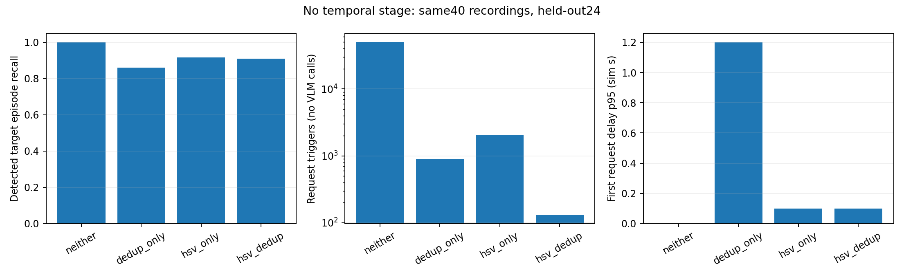
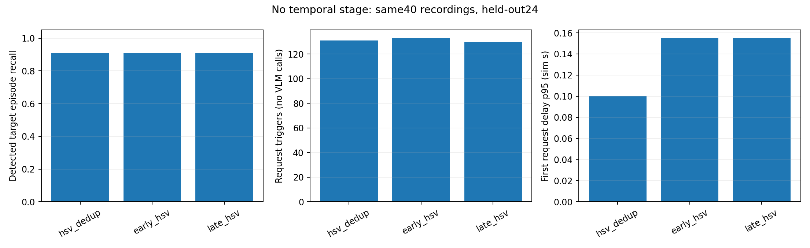

# 시간적 확인 제거 후 필터 유무·배치 비교

기존40개 녹화와 동일한 YOLO/HSV 캐시를 재사용했다. 추가녹화와 실제VLM호출은없다. 평가24개/개발16개를 유지하며, 모든구성에서temporal=False다. 이전26구성의원자료·결과파일은덮어쓰지않았다.

| 구성 | HSV | dedup | 추적과 색상 선별의 관계 |
|---|---|---|---|
| neither | 끔 | 끔 | 모든 차량 추적·후보 |
| dedup_only | 끔 | 켬 | 모든 차량 추적 후 중복 억제 |
| hsv_only | 켬 | 끔 | 색상 라벨 부여 → 전체 차량 추적 → 목표 색 gate |
| hsv_dedup (현재) | 켬 | 켬 | 색상 라벨 부여 → 전체 차량 추적 → 목표 색 gate → dedup |
| early_hsv | 켬 | 켬 | 목표 색 검출만 남김 → 추적 → dedup |
| late_hsv | 켬 | 켬 | 색상을 사용하지 않고 추적 → 현재 색 gate → dedup |

HSV를끄면색상정보를추적재연결과중복연속성에도사용하지않는다. 따라서HSV제거효과에는단순목표색선별뿐아니라ID연결의변화도포함된다.

dedup은track식별자를필요로하므로추적앞으로단순교환하지않는다. 후보가통과하기전에쿨다운을소비하는설계도같은정책의순서변경이라고취급하지않았다. 배치대안은추적에색상정보를사용하는방식도바꾸므로순서만의인과효과가아니다.

## 평가 결과

| 구성 | 도달 출현/121 | 도달률 | 도달 고유 차량/92 | 요청 트리거 | 비목표 요청 | 미확정 요청 | 요청 지연 p95(s) |
|---|---:|---:|---:|---:|---:|---:|---:|
| neither | 121 | 100.0% | 92 | 50282 | 19199 | 28893 | 0.000 |
| dedup_only | 104 | 86.0% | 83 | 894 | 631 | 157 | 1.200 |
| hsv_only | 111 | 91.7% | 84 | 2036 | 0 | 10 | 0.100 |
| hsv_dedup | 110 | 90.9% | 83 | 131 | 0 | 6 | 0.100 |
| early_hsv | 110 | 90.9% | 83 | 133 | 0 | 6 | 0.155 |
| late_hsv | 110 | 90.9% | 83 | 130 | 0 | 6 | 0.155 |

도달률은검출된출현구간기준이며실제VLM정확도가아니다. 요청은검증을요구했을트리거다. 미확정요청을입증된오검출로부르지않는다. 지연은첫검출→요청트리거까지의시뮬레이션시간이고VLM응답·최종경보지연은미측정이다.

YOLO/HSV를한번계산한캐시로판단흐름을비교했으므로구조전체의실제계산시간절감을입증하지않는다. GT연결근사·지도별날씨조건차이등한계는[기존실험요약](../SUMMARY.ko.md)과같다.

[녹화별 결과](per_recording.csv) · [현재 구조 대비 paired 구간](paired_vs_current.csv)

현재 HSV+dedup은 110/121도달·131요청이고, HSV만 쓰면111/121도달·2036요청이다. 중복억제가요청을크게줄이는한편약간의목표손실도있다. 배치세종류는도달률이같고요청130~133건으로차이가작아, 특정순서가유일한정답이라고결론내리지않았다. 현재배치를유지하되 시간적확인만제외한다.

## 최종 권장 구조
**YOLO → HSV 색상 라벨 → 전체 차량 추적 → 현재 목표 색 선별 → 대상별 중복 억제 → 검증 요청**. 기존 production 구조에서 시간적 확인만 제외한 구조다.

선택 근거는 이번 입력에서 HSV와 dedup의 요청 절감 역할이 확인됐고, HSV 배치 대안의 목표 출현 도달률과 고유 차량 도달 수는 현재 구조와 같았기 때문이다. 현재131요청·0.100초p95, 조기HSV133요청·0.155초, 추적후HSV130요청·0.155초로 순서 변경의 이득이 크지 않아 기존 순서를 유지한다.

HSV만 쓰면111/121출현에 도달하지만2036요청이며, HSV+dedup은110/121·131요청이다. 약간의 도달 손실과 큰 요청 절감이 있는 절충이다. 이 선택은 실험 범위 내 권장안이며 모든 가능한 설계의 절대 최적이나 실제VLM 이후 최종 경보 성능의 최적성을 뜻하지 않는다. 순서 변경보다 시간적 확인 제거가 이번의 주요 변경이다.
